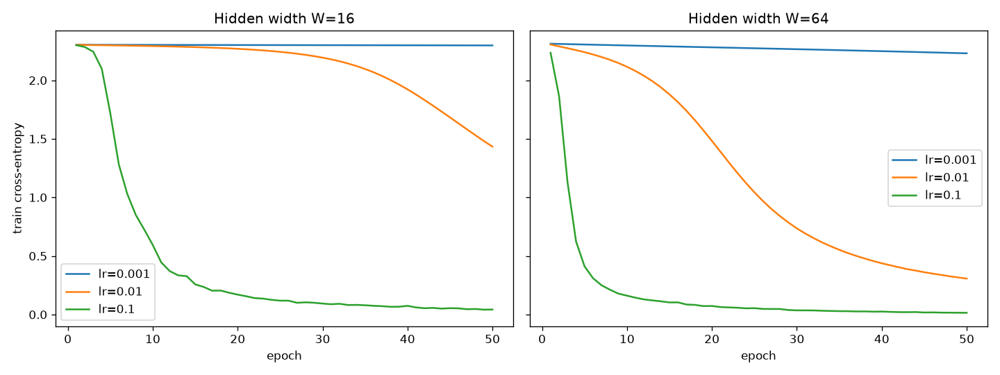

# Lab 2: A neural network from scratch

## 1. Goal
Build a two-hidden-layer neural network in NumPy only (forward pass, cross-entropy, backpropagation), verify the
hand-derived gradients numerically, and study how learning rate and hidden width affect training, and how
forward and backward passes compare in time.

## 2. Method
- Data: `load_digits`, inputs divided by 16, one-hot labels, 70/30 stratified split, `random_state=42`
  (1257 train / 540 test).
- Network design (on paper):

  | Layer | Operation | Weight shape | Bias shape |
  |---|---|---|---|
  | 1 | 64 → W, ReLU | (64, W) | (W,) |
  | 2 | W → W, ReLU | (W, W) | (W,) |
  | 3 | W → 10, softmax | (W, 10) | (10,) |

  W = 16 (1 546 parameters) and W = 64 (8 970 parameters). Weights ~ N(0, 0.01), read as mean 0 and
  **variance** 0.01 (std 0.1); biases are zero.
- Gradients (chain rule): for softmax + cross-entropy, dL/dz3 = (p − y)/N. Then for each layer
  dW = aᵀ·dz, db = Σ dz, da_prev = dz·Wᵀ, and through ReLU dz = da · 1[z > 0].
- Gradient check: 10 random weights, central difference with ±1e-5, relative error
  |a − n| / (|a| + |n|).
- Training: shuffle each epoch, mini-batch 32, 50 epochs, plain SGD, learning rates {0.001, 0.01, 0.1} ×
  widths {16, 64}.
- Timing: batch 32, forward and backward measured separately, median of 100 runs.
- Code: `src/nn.py`, `src/run_all.py`. Run: `python lab02/src/run_all.py`.

## 3. Results

**Sanity checks** (`results/sanity_checks.txt`): output shape is (batch, 10), every row sums to 1 (within 1e-6).
Untrained loss is 2.3032 (W=16) and 2.3110 (W=64), close to ln(10) = 2.3026.

**Gradient check** (`results/gradient_check.csv`): **10 / 10 weights pass**, relative error between
5e-10 and 2.5e-8 (limit 1e-6). Two of the sampled W2 weights had exactly zero gradient, because they belong to
ReLU units that are inactive on the check batch; analytic and numerical values are both 0 there.

**Training** (`results/training_results.csv`, curves in `results/loss_curves.png`)

| Width | lr | Final train loss | Test accuracy |
|---|---|---|---|
| 16 | 0.001 | 2.2977 | 0.1833 |
| 16 | 0.01 | 1.4335 | 0.6315 |
| 16 | 0.1 | 0.0425 | 0.9556 |
| 64 | 0.001 | 2.2301 | 0.3593 |
| 64 | 0.01 | 0.3066 | 0.9204 |
| 64 | 0.1 | 0.0147 | **0.9667** |

**Timing** (`results/timing.csv`, batch 32, median of 100)

| Width | Forward (µs) | Backward (µs) | Backward / forward |
|---|---|---|---|
| 16 | 55.0 | 59.8 | 1.09 |
| 64 | 92.9 | 119.0 | 1.28 |

The backward pass dominates. Forward needs one matrix multiplication per layer (X·W). Backward needs two per layer:
one for the weight gradient (aᵀ·dz) and one for the gradient to pass back (dz·Wᵀ), plus ReLU masks. So in theory
it costs about 2× the forward pass. We measure only 1.1–1.3× because the matrices are tiny (at most 32×64·64×64)
and fixed Python/NumPy call overhead is a large part of the time. When W grows from 16 to 64, the ratio moves
closer to 2, because matrix multiplication becomes a larger part of the total time.

## 4. Conclusions
1. The hand-derived backpropagation is correct: all 10 checked weights agree with the numerical slope to better
   than 1e-7, so later differences between runs come from hyper-parameters, not from bugs.
2. The learning rate matters more than width here: with lr = 0.001 the loss barely moves from ln(10) after
   50 epochs, while lr = 0.1 reaches 95–97% accuracy. With a small init, a small learning rate gives very slow
   progress at the start.
3. The wider network learns faster and reaches higher accuracy (96.7% vs 95.6%), but it costs ~6× more
   parameters and ~1.7–2× more time per step. Backward is the most expensive part, because it doubles the number
   of matrix multiplications.
