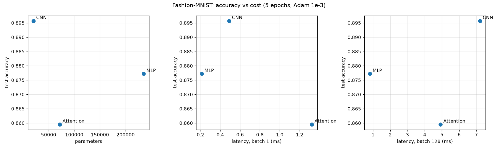

# Lab 3: Architectures and their costs

## 1. Goal
Compare an MLP, a CNN and a small attention (Transformer) model on Fashion-MNIST, by accuracy and by system
cost: parameters, FLOPs (hand-calculated vs `thop`) and inference latency.

## 2. Method
- Data: `torchvision.datasets.FashionMNIST`, `ToTensor()` + `Normalize((0.2860,), (0.3530,))`. Official 60k train
  split into 55k train / 5k validation (`random_split`, seed 42), official 10k test, batch size 128.
- Models (`src/models.py`), as specified in the manual:
  - MLP: Flatten 784 → 256 → ReLU → 128 → ReLU → 10.
  - CNN: Conv(1→16, 3×3, pad 1) → ReLU → MaxPool2 → Conv(16→32) → ReLU → MaxPool2 → Linear(1568→10).
  - Attention: 16 patches of 7×7 → Linear(49→64) + learned positional embedding → 2 × TransformerEncoderLayer
    (d_model 64, 4 heads, FF 128, dropout 0) → mean pool → Linear(64→10).
- Parameters: `torchinfo.summary`. FLOPs: Ch. 4 formulas (1 MAC = 2 FLOPs) vs `thop.profile` (reports MACs; ×2).
- Latency: CPU, `torch.inference_mode()`, 1 warm-up, median of 100 runs (batch 1) and 20 runs (batch 128).
- Training: 5 epochs, Adam, lr 1e-3, batch 128, seed 42. Run: `python lab03/src/run_all.py`.

## 3. Results

**Hand-calculated FLOPs for one layer of each type** (`results/hand_flops_layers.csv`)

| Layer | Formula | FLOPs |
|---|---|---|
| MLP Linear 784→256 | 2 × 784 × 256 | 401 408 |
| CNN Conv2d 16→32, 3×3, 14×14 output | 2 × 3 × 3 × 16 × 32 × 14 × 14 | 1 806 336 |
| Encoder layer: QKV projections | 2 × 16 × 64 × 3 × 64 | 393 216 |
| Encoder layer: scores QKᵀ | 2 × 16² × 64 | 32 768 |
| Encoder layer: scores × V | 2 × 16² × 64 | 32 768 |
| Encoder layer: output projection | 2 × 16 × 64 × 64 | 131 072 |
| Encoder layer: feed-forward | 16 × (2·64·128 + 2·128·64) | 524 288 |
| **Encoder layer total** | | **1 114 112** |

**Whole-model cost and accuracy** (`results/architecture_costs.csv`, plots in `results/tradeoff_plots.png`)

| Model | Params | Hand FLOPs | thop FLOPs | thop / hand | Latency b=1 (ms) | Latency b=128 (ms) | Test accuracy |
|---|---|---|---|---|---|---|---|
| MLP | 235 146 | 469 504 | 469 504 | 1.00 | 0.212 | 0.813 | 0.8772 |
| CNN | 20 490 | 2 063 488 | 2 063 488 | 1.00 | 0.490 | 7.207 | **0.8957** |
| Attention | 71 818 | 2 329 856 | 1 182 976 | 0.51 | 1.323 | 4.921 | 0.8595 |

**Parameter target.** The manual asks for 100k–150k parameters, but the exact architectures it specifies give
235k (MLP), 20k (CNN) and 72k (Attention). I kept the specified architectures unchanged so that the hand
calculations match the definition, and I compare them as they are.

**Gap between hand and `thop` FLOPs.** For the MLP and CNN the numbers match exactly (ReLU and pooling are ignored
by both). For the Attention model `thop` reports only half: it has no counting rule for `nn.MultiheadAttention`, so
the QKV projections, both attention matmuls and the output projection (2 × 589 824 = 1 179 648 FLOPs) are counted
as zero. It counts the patch projection, the feed-forward `nn.Linear` layers and the head, plus ~33k for LayerNorm,
which my hand count leaves out. Profilers count only the module types they know, so their result for new layer
types must be checked.

## 4. Explanation of trade-offs (Ch. 4.6–4.7)
- **MLP**: most parameters but fewest FLOPs. Every weight is used once per image (dense matrix-vector product), so
  at batch 1 it is memory-bound (it reads 0.94 MB of weights to do 0.47 MFLOP) but still the fastest, because it is
  one simple GEMM per layer. It ignores the 2-D structure of the image, so accuracy is lower.
- **CNN**: 11× fewer parameters than the MLP but 4× more FLOPs, because each small 3×3 kernel is reused at every
  spatial position (high arithmetic intensity, good weight reuse). It has the best accuracy. At batch 128 it is the
  slowest, because the convolution activations (16×28×28 and 32×14×14 per image) are large and must be written and
  read for each image.
- **Attention**: medium parameter count, the highest FLOPs and the highest batch-1 latency. Many small kernels
  (reshape, QKV, softmax, LayerNorm) with irregular, data-dependent access patterns give a large launch overhead,
  and attention scores grow as seq². With only 5 epochs and no image prior it is also the least accurate.
- **Most cost-effective**: the **CNN**. It has the best accuracy with the smallest model (80 KB of float32 weights),
  so it fits easily in memory, and it has acceptable latency (0.49 ms per image). The MLP is the choice only if
  latency is the single priority.

## 5. Conclusions
1. Parameter count, FLOPs and latency are different measures: the smallest model (CNN) has the most FLOPs per
   parameter, and the model with the most parameters (MLP) is the fastest.
2. Architecture prior beats size: the CNN uses 11× fewer weights than the MLP and still gives +1.9 points of
   accuracy, because convolutions share weights over the image.
3. Profiling tools are not ground truth: `thop` missed half the work of the attention model. Hand calculations
   with the Ch. 4 formulas are needed to check what a tool actually counts.
